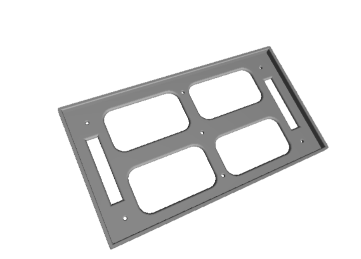
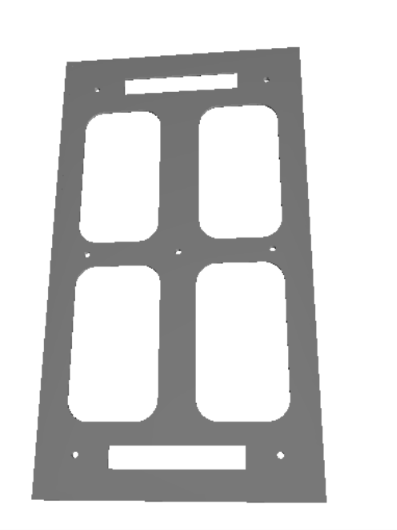
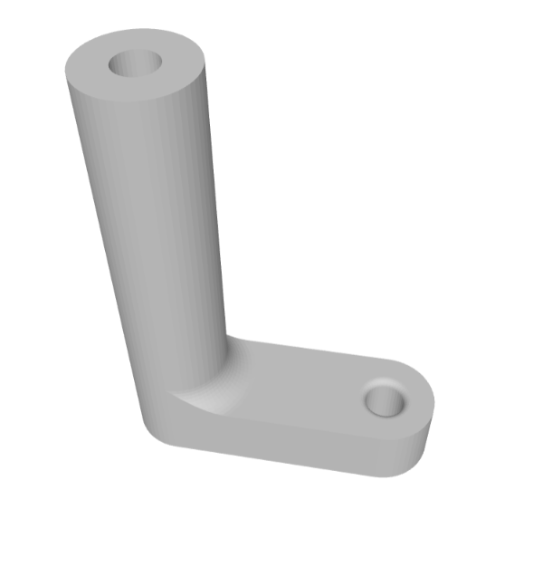
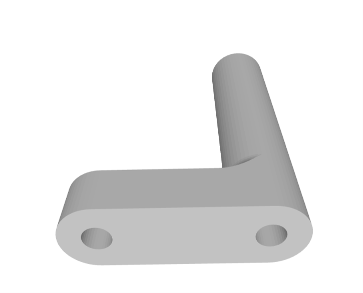

# 3D Printed Mechanical Mounts & Enclosures

### **TEAM DISTRO**
**Lam Research Challenge 3.0 – Practical Engineering Challenge (Stage 2)**

---

## 📌 Overview

This directory contains the AutoCAD-designed 3D-printable CAD models (`.stl` files) and mounting fixtures created for the **TEAM DISTRO** automated liquid-handling and recirculation testbed. These fixtures ensure rigid, vibration-resistant, and chemically isolated mounting for electrical supplies, control PCBs, and hydraulic piping.

---

## 🗂️ 3D Print File Index

| Component | STL File | Quantity | Purpose |
|---|---|:---:|---|
| **SMPS Clamp** | [`stl/smps clamp.stl`](stl/smps%20clamp.stl) | 1 | Mounts and secures the 12V DC power supply unit with ventilation windows |
| **PCB Foot / Mounting Clamp** | [`stl/PCB foot01.stl`](stl/PCB%20foot01.stl) | 4 | Elevated standoff feet to isolate and mount the control circuit PCB |
| **Pipe / Tubing Clamp** | [`stl/pipe clamp.stl`](stl/pipe%20clamp.stl) | Multiple | Secures and routes 8mm hydraulic tubing cleanly to eliminate vibration and kinking |

---

## 🛠️ Component Details & Image Gallery

### 1. SMPS Mounting Clamp
Custom ventilated rectangular bracket designed to firmly clamp the 12V SMPS (Switched-Mode Power Supply) to the rig's mounting baseplate. Includes thermal dissipation cutouts to prevent overheating during continuous pump operation.

<table>
  <tr>
    <td align="center"><b>Isometric View</b></td>
    <td align="center"><b>Top / Plan View</b></td>
  </tr>
  <tr>
    <td></td>
    <td></td>
  </tr>
</table>

- **File:** [`stl/smps clamp.stl`](stl/smps%20clamp.stl)
- **Features:**
  - 4 large ventilation cutouts for natural airflow and heat dissipation.
  - Recessed corner screw holes and retention slots for fasteners / zip-ties.
  - Flush perimeter lip to prevent lateral sliding of the power supply unit.

---

### 2. PCB Mounting Clamp (Standoff Foot)
Rigid elevated standoff designed to mount the custom ESP32 control board and H-bridge motor driver circuitry above the baseplate, providing electrical isolation and strain relief.

<table>
  <tr>
    <td align="center"><b>Perspective View 1</b></td>
    <td align="center"><b>Perspective View 2 (Bottom Countersink)</b></td>
  </tr>
  <tr>
    <td></td>
    <td></td>
  </tr>
</table>

- **File:** [`stl/PCB foot01.stl`](stl/PCB%20foot01.stl)
- **Features:**
  - L-shaped offset geometry allowing easy access for screwdriver assembly.
  - Cylindrical standoff pillar with screw hole for PCB corner mounting.
  - Countersunk base mounting hole for M3/M4 chassis fastening.

---

### 3. Pipe & Tubing Mounting Clamp
Curved guide clamp designed to secure 8mm outer-diameter polyurethane/silicone fluid tubing along the chassis rails, preventing tube detachment under pump pulse pressure.

<table>
  <tr>
    <td align="center"><b>Pipe Clamp Isometric View</b></td>
  </tr>
  <tr>
    <td align="center"></td>
  </tr>
</table>

- **File:** [`stl/pipe clamp.stl`](stl/pipe%20clamp.stl)
- **Features:**
  - Smooth cylindrical collar preventing pinch points or constriction of liquid flow.
  - Right-angled chassis mounting arm with pre-drilled screw hole for quick panel attachment.

---

## 🖨️ Recommended Slicer & Print Settings

| Setting | Recommended Value | Notes |
|---|---|---|
| **Material** | PLA / PETG / ABS | PETG is recommended for fluid-splash resistance |
| **Layer Height** | `0.20 mm` | `0.16 mm` for PCB foot mounting holes |
| **Infill Density** | `25% - 40%` | Gyroid or Grid pattern for maximum structural rigidity |
| **Wall Perimeters** | `3 - 4` walls | Ensures screw holes do not crack under torque |
| **Top / Bottom Layers** | `4 / 4` | Flat surface stability |
| **Supports** | Minimal / None | Orient flat on the build plate for support-free printing |

---

Designed in AutoCAD and fabricated by <b>TEAM DISTRO</b> for Lam Research Challenge 3.0

