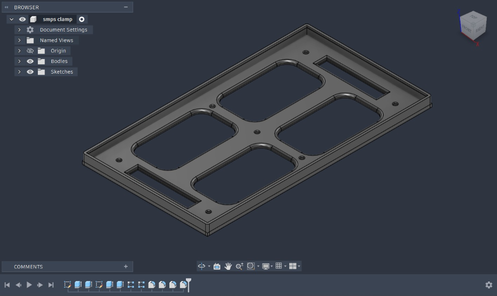

# 3D Printed Mechanical Mounts & Enclosures

### **TEAM DISTRO**
**Lam Research Challenge 3.0 – Practical Engineering Challenge (Stage 2)**

---

## 📌 Overview

This directory contains the AutoCAD / Autodesk CAD models, engineering 2D sketch blueprints, and `.stl` mesh files designed for the **TEAM DISTRO** automated liquid-handling and recirculation rig. These mechanical fixtures provide rigid, vibration-damped, and electrically isolated mounting for the 12V SMPS, control PCB, and fluid delivery lines.

---

## 🗂️ 3D Print File & Specification Index

| Component | STL File | Quantity | Key Dimensions | Purpose |
|---|---|:---:|---|---|
| **SMPS Clamp** | [`stl/smps clamp.stl`](stl/smps%20clamp.stl) | 1 | ~200 × 100 mm frame, R10 fillets, 17×3 mm slots | Secures 12V SMPS with dedicated thermal ventilation windows |
| **PCB Foot Clamp** | [`stl/PCB foot01.stl`](stl/PCB%20foot01.stl) | 4 | Ø7.0 mm OD pillar, Ø3.0 mm bore, 7.0 mm base | Elevated standoff feet to isolate and mount the control circuit PCB |
| **Pipe / Tubing Clamp** | [`stl/pipe clamp.stl`](stl/pipe%20clamp.stl) | Multiple | 8–10 mm bore, 90° bracket, counterbored hole | Guides and secures 8mm hydraulic tubing along the chassis |

---

## 🛠️ CAD Blueprints, Dimensions & Image Gallery

### 1. SMPS Mounting Clamp

Custom ventilated rectangular bracket designed to clamp the 12V DC Switched-Mode Power Supply firmly against the rig mounting plate while facilitating passive convective heat transfer.

<table>
  <tr>
    <td align="center"><b>CAD Technical Dimension Blueprint (Top Sketch)</b></td>
    <td align="center"><b>3D CAD Solid Model (Isometric View)</b></td>
  </tr>
  <tr>
    <td></td>
    <td></td>
  </tr>
  <tr>
    <td align="center"><b>Fabrication Isometric Render</b></td>
    <td align="center"><b>Plan View</b></td>
  </tr>
  <tr>
    <td></td>
    <td></td>
  </tr>
</table>

#### 📐 Geometric Dimensions & Features:
| Parameter | Dimension / Value | Engineering Function |
|---|---|---|
| **Overall Footprint** | ~`200.00 mm` × `100.00 mm` | Sized to cradle standard 12V 10A–20A industrial SMPS casings |
| **Ventilation Windows** | 4 quadrants, `R10.00 mm` corner radii | Unrestricted airflow to SMPS perforated heatsink surface |
| **Retention Slots** | `17.00 mm` (L) × `3.00 mm` (W) | Cable-tie / strap pass-through slots (`8.50 mm` half-offset) |
| **Edge Margin to Slots** | `16.00 mm` / `30.00 mm` | Symmetrical top & bottom margin spacing |
| **Fastening Holes** | `Ø3.40 mm` clearance (M3) | Located at `15.00 mm` corner offsets and center cross-rib |
| **Internal Fillets** | `R10.00 mm` continuous | Eliminates sharp stress concentration notches during vibration |
| **Perimeter Retention Lip** | Raised boundary rim | Constrains lateral displacement under operational pump vibration |

- **CAD File:** [`stl/smps clamp.stl`](stl/smps%20clamp.stl)

---

### 2. PCB Mounting Clamp (Standoff Foot)

Rigid elevated standoff designed to mount the custom ESP32 control board and H-bridge motor driver circuitry above the baseplate, providing electrical isolation and strain relief.

<table>
  <tr>
    <td align="center"><b>CAD Technical Dimension Blueprint (2D Sketch)</b></td>
    <td align="center"><b>3D CAD Solid Model with Transition Fillet</b></td>
  </tr>
  <tr>
    <td></td>
    <td></td>
  </tr>
  <tr>
    <td align="center"><b>Perspective View 1</b></td>
    <td align="center"><b>Perspective View 2 (Countersunk Base)</b></td>
  </tr>
  <tr>
    <td></td>
    <td></td>
  </tr>
</table>

#### 📐 Geometric Dimensions & Features:
| Parameter | Dimension / Value | Engineering Function |
|---|---|---|
| **Standoff Column Outer Diameter** | `Ø7.00 mm` | Provides high axial buckling resistance |
| **Central Screw Pilot Bore** | `Ø3.00 mm` | Sized for standard M3 self-tapping or machine screw retention |
| **Base Foot Width** | `7.00 mm` | Matches column diameter for a compact footprint |
| **Chassis Fastening Hole** | `Ø3.00 mm` with counterbore | Allows recessed screw head mounting flush with chassis surface |
| **Fillet Radius at Joint** | Structural blend radius | Strengthens the 90° cantilever joint against shearing stresses |
| **Mounting Height** | Elevated clearance | Electrically isolates solder points and provides under-board airflow |

- **CAD File:** [`stl/PCB foot01.stl`](stl/PCB%20foot01.stl)

---

### 3. Pipe & Tubing Mounting Clamp

Curved guide clamp designed to secure 8mm outer-diameter polyurethane/silicone fluid tubing along the chassis rails, preventing tube detachment under pump pulse pressure.

<table>
  <tr>
    <td align="center"><b>CAD Mesh & Hybrid Topology View</b></td>
    <td align="center"><b>Physical Form Isometric View</b></td>
  </tr>
  <tr>
    <td></td>
    <td></td>
  </tr>
</table>

#### 📐 Geometric Dimensions & Features:
| Parameter | Dimension / Value | Engineering Function |
|---|---|---|
| **Tubing Bore Diameter** | `8.00 mm – 10.00 mm` | Secure pass-through collar for standard liquid lines |
| **Collar Geometry** | Smooth cylindrical cuff | Uniform contact pressure prevents pinching or flow constriction |
| **Mounting Arm** | 90° right-angled offset | Allows flush mounting against vertical rig chassis rails |
| **Fastener Hole** | Countersunk M3/M4 hole | Secures bracket firmly to extrusion profile or backplate |

- **CAD File:** [`stl/pipe clamp.stl`](stl/pipe%20clamp.stl)

---

## 🖨️ Recommended Slicer & 3D Print Settings

| Setting | Value | Engineering Rationale |
|---|:---:|---|
| **Material** | **PLA / PETG** | PETG is preferred for fluid-handling rigs due to chemical and moisture resistance |
| **Layer Height** | **0.20 mm** | Balanced print speed and layer adhesion (use `0.16 mm` for PCB foot pilot holes) |
| **Infill Density** | **30% – 45%** | Gyroid or Cubic infill for isotropic mechanical rigidity |
| **Wall Perimeters** | **3 – 4 walls** | Prevents hoop stress cracking when torquing M3 screws |
| **Top / Bottom Solid Layers** | **4 / 4 layers** | Ensures leak-free and warp-resistant planar clamping surfaces |
| **Print Orientation** | Flat on build plate | Minimizes overhangs; requires **zero support material** |

---

Designed in AutoCAD / Autodesk Fusion and fabricated by <b>TEAM DISTRO</b> for Lam Research Challenge 3.0

