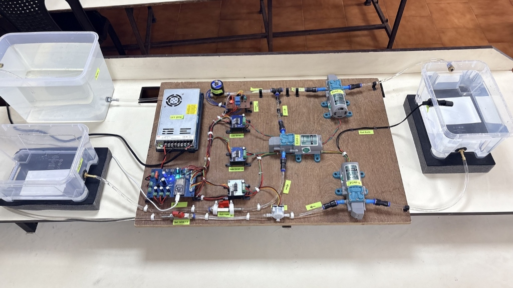
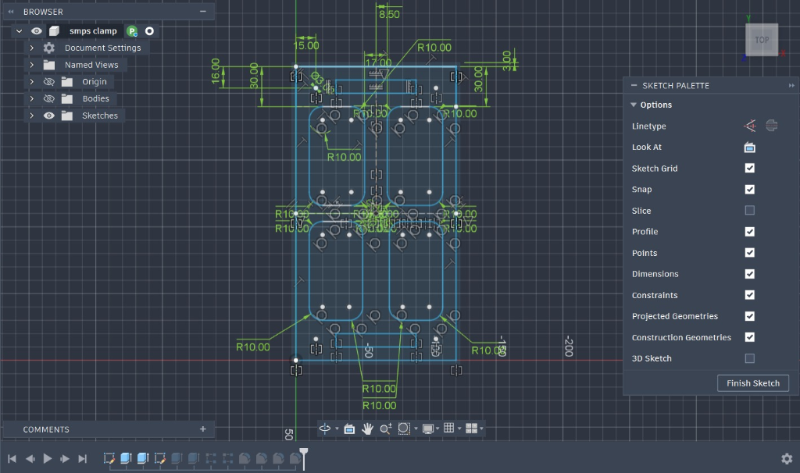
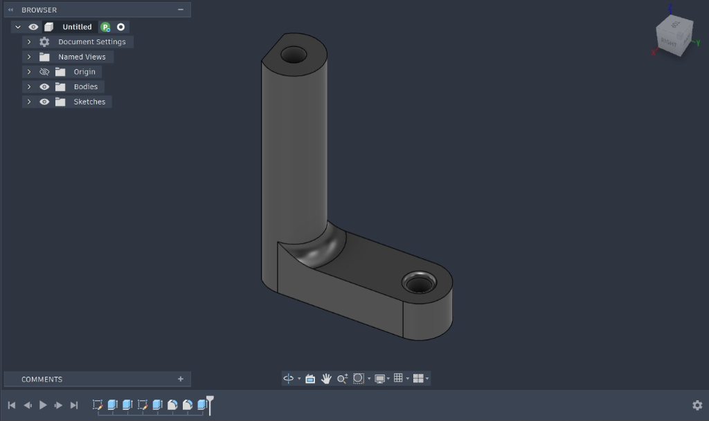
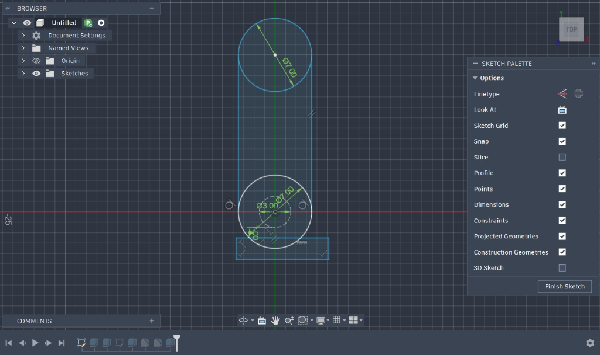
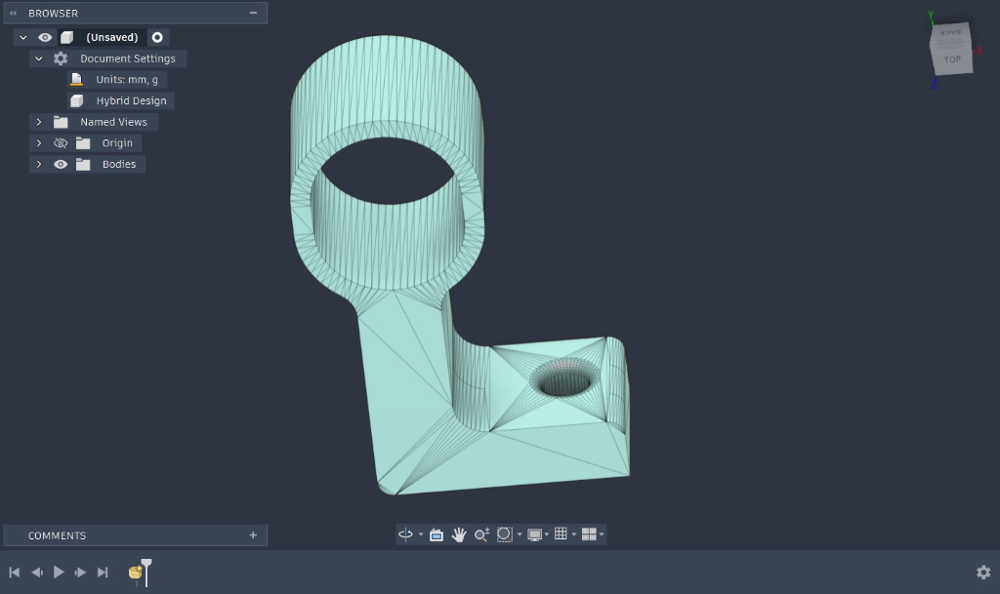
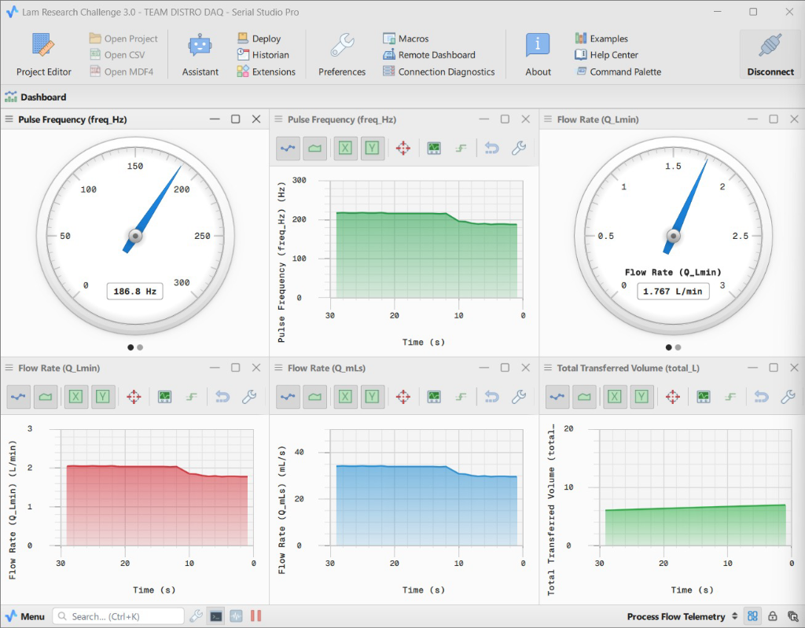
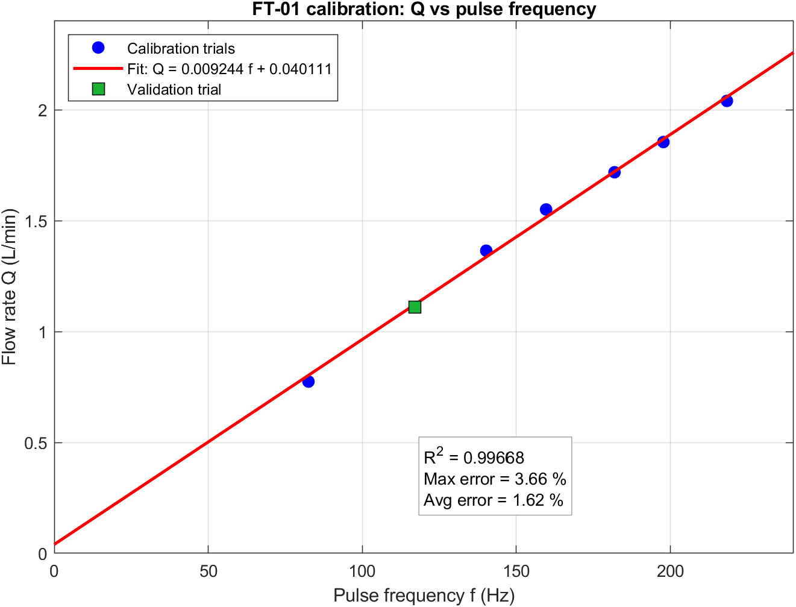
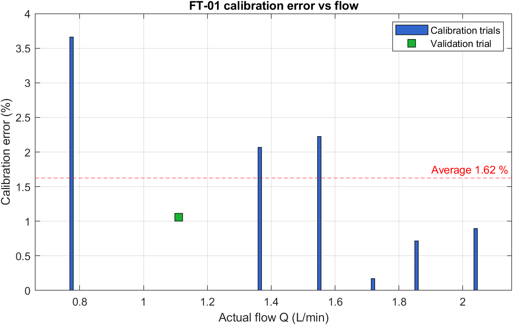
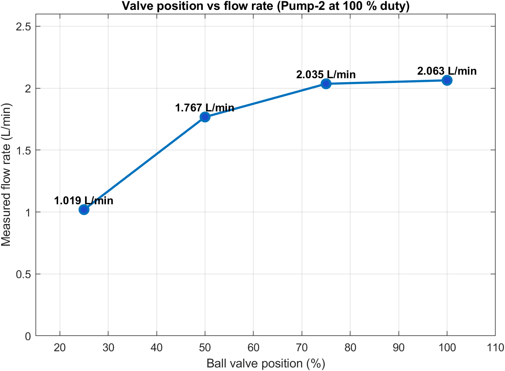

# Lam Research Challenge 3.0: Stage 2 Practical Engineering Challenge

<div align="center">


[](https://github.com/Sonalhegde/TEAM_DISTRO/actions)
[](https://sonalhegde.github.io/TEAM_DISTRO/)


### **Team DISTRO**
**Automated Liquid-Handling, Recirculation, and Telemetry Platform**

👉 **[Launch Live 3D Digital Twin Simulation](https://sonalhegde.github.io/TEAM_DISTRO/)** 👈
    **📊 Team DISTRO Presentation: https://drive.google.com/file/d/10BZNDP2cnqSBqfE3b11lk_6qCRlyOtN2/view?usp=drive_link
📄 Stage 2 Practical Engineering Challenge PDF: https://drive.google.com/file/d/1mI3886kun4H3olHrglMHzYJjbUjEaSkm/view?usp=drive_link
🎥 Rig Automation & Testing Journey Video: https://drive.google.com/file/d/1YkWeLo3Ct3zWrAMsbKcDU-8LQFBE7EN8/view?usp=drive_link**

<br/><br/>



*Figure 1: Physical Experimental Rig Setup — 10 L main reservoir, 4.2 L flush reservoir, 4.5 L sump, 3 pumps, BTS7960 drivers, ESP32 NodeMCU-32S, FT-01 pulse turbine flow meter, solenoid valve OV-01, and float switch LS-01.*

</div>

This repository provides the complete embedded controller firmware, MATLAB calibration analysis scripts, 3D printable CAD models, and real-time DAQ dashboard for the Lam Research Challenge 3.0 Stage 2 automated liquid-handling rig (Team ID: LRC-26-0528).
The system uses an ESP32 microcontroller with high-power BTS7960 H-bridge drivers to regulate fluid recirculation, protect against sump overflow surges, and execute automated line flushes with live serial telemetry.
All engineering documentation, build instructions, Git workflows, and calibration derivations are unified in this document.

---

## 1. Team Members & Project Roles

- **Institution:** Nitte (Deemed to be University) - NMAM Institute of Technology
- **Team Identifier:** LRC-26-0528 | **Team Name:** Team DISTRO

| Name | Role | Department | USN | Email | GitHub | Contribution |
|---|---|---|---|---|---|---|
| **Sonal Hegde** | Team Leader | Department of ECE | NNM24AC050 | [nnm24ac050@nmamit.in](mailto:nnm24ac050@nmamit.in) | [@Sonalhegde](https://github.com/Sonalhegde) | Coding and Documentation |
| **Pratham Amin** | Member | Department of Mechanical Engineering | NNM24ME084 | [nnm24me084@nmamit.in](mailto:nnm24me084@nmamit.in) | [@pratham885](https://github.com/pratham885) | Piping, 3D Printing, CAD, Layout Designing, and Calibration |
| **Jostan Saldanha** | Member | Department of ECE | NNM25AC502 | [nnm25ac502@nmamit.in](mailto:nnm25ac502@nmamit.in) | [@jostan-saldanha](https://github.com/jostan-saldanha) | Electronics and Firmware |
| **Mohammed Araan** | Member | Department of CSE | NNM24CS142 | [nnm24cs142@nmamit.in](mailto:nnm24cs142@nmamit.in) | [@Araan-Sheikh](https://github.com/Araan-Sheikh) | Video Editing and 3D Modelling |

---

## 2. System Overview

The controller finite state machine (FSM) executes automated liquid handling across two primary operating cases, governed by strict level interlocks and hydrodynamic thresholds:

### Operational State Matrix
All operational states are implemented in [`firmware/main/config.h`](firmware/main/config.h) and managed by the non-blocking control loop:

| State Name | State ID | Solenoid OV-01 | Pump 1 Duty | Pump 2 Duty | Pump 3 Duty | Entry & Exit Conditions |
|---|:---:|:---:|:---:|:---:|:---:|---|
| **`ST_IDLE`** | 0 | CLOSED (High-Z) | 0% | 0% | 0% | Safe standby. Awaits operator start command (`1`, `2`, `a`, or SW-01). |
| **`ST_CASE1_NORMAL`** | 1 | OPEN (Active LOW) | 50% | 100% | 0% | Recirculates fluid at steady 3.0 L/min. Transitions to `ST_CASE1_SURGE` if LS-01 trips. |
| **`ST_CASE1_SURGE`** | 2 | OPEN (Active LOW) | 0% | 100% | 0% | Overflow protection interlock. Pump 1 halted; Pump 2 clears sump until LS-01 clears for 3.0 s. |
| **`ST_CASE2_FLUSHING`** | 3 | CLOSED (High-Z) | 50% | 100% | 100% | Concurrent 3-pump flush. Shuts down when flow collapses (< 0.35 L/min) or delivered volume reaches 4.15 L. |
| **`ST_CASE2_STOPPING`** | 4 | CLOSED (High-Z) | 0% | 0% | 0% | Flush line post-run staggered shutdown (pumps OFF, 500 ms anti-water-hammer delay). |
| **`ST_FAULT`** | 5 | CLOSED (High-Z) | 0% | 0% | 0% | Emergency lockout on dry-run timeout (> 3.0 s) or sensor failure. Requires manual reset. |
| **`ST_CASE1_DRAIN`** | 6 | CLOSED (High-Z) | 0% | 100% | 0% | Sump evacuation prior to line flush (Pump 2 active, OV-01 closed). |
| **`ST_CALMODE`** | 7 | As commanded | Manual | Manual | Manual | Bench calibration DAQ mode (interactive CLI with safety guards). |

### Case 1: Closed-Loop Recirculation with Sump Level Protection
- **Normal Recirculation:** Solenoid valve OV-01 opens (with a 200 ms non-blocking lead to pre-flood the suction line). Pump-1 operates at 50% PWM duty cycle to feed fluid from the 10 L main reservoir into the sump, while Pump-2 runs at 100% duty cycle to pump fluid through the FT-01 turbine flow meter and return it to the 10 L tank, maintaining steady 3.0 L/min closed-loop recirculation.
- **Sump Surge Interlock:** When external liquid causes the sump level to rise, float switch LS-01 trips (contact closes to GND, active LOW). The controller immediately halts Pump-1 (0% duty) while keeping Pump-2 running at 100% duty cycle to evacuate excess liquid back to the 10 L tank, preventing any spill.
- **Automatic Recovery:** Once the sump level drops below the float switch threshold and remains clear for 3.0 seconds (`SURGE_CLEAR_CONFIRMATION_MS`), Pump-1 automatically restarts at 50% duty cycle, and normal recirculation resumes without manual intervention.

### Case 2: Multi-Pump Line Flush and Autonomous Safe Shutdown
- **10 L Reservoir Isolation:** Solenoid valve OV-01 closes, isolating the 10 L process reservoir from the flow circuit.
- **Concurrent Multi-Pump Flushing:** Pump-1 (50%), Pump-2 (100%), and Pump-3 (100%) operate simultaneously to draw deionized flush water from the 4.2 L flush reservoir through the entire piping network.
- **Autonomous Depletion Shutdown:** The FT-01 sensor continuously measures delivered volume and line velocity; when the 4.2 L flush reservoir empties and fluid flow collapses below 0.35 L/min (`C2_FLOW_COLLAPSE_LPM`) indicating cavitation/air entrainment for $> 1.0$ s, or when delivered volume reaches the 4.15 L volumetric ceiling (`FLUSH_VOLUME_CEILING_L`), the controller automatically shuts off all three pumps. After a 500 ms anti-water-hammer delay (`SOV_STAGGERED_CLOSE_DELAY_MS`), OV-01 is confirmed closed, and the system safely transitions to idle.

### Hydrodynamic Thresholds
1. **Low-Frequency Noise Gate (`FLOW_CUTOFF_HZ = 1.0 Hz` / ~0.049 L/min):** Frequencies below 1.0 Hz are forced to 0.00 L/min to suppress zero-flow integration creep caused by pump vibration.
2. **Priming Verification Threshold (`FLOW_MIN_VALID_LPM = 0.50 L/min`):** Fluid velocity required to confirm that the suction line has primed and positive flow is established.
3. **Cavitation / Air Suction Collapse Threshold (`C2_FLOW_COLLAPSE_LPM = 0.35 L/min`):** Sudden drop below 0.35 L/min after flush delivery indicates line aeration and confirms reservoir exhaustion.

---

## 3. Hardware Components & Electrical Pinout

### Fluid Process Architecture & Routing
The hydraulic circuit connects three dedicated reservoirs via 8 mm polyurethane tubing:
- **10 L Main Process Tank:** Primary liquid reservoir. Supplies fluid through Solenoid Valve OV-01 to the sump, and receives returned fluid from Pump 2 discharge through the FT-01 turbine flow meter.
- **4.2 L Flush Tank:** Supplies deionized flush liquid directly to the suction side of Pump 3 during Case 2 automated line clearance.
- **4.5 L Sump Vessel:** Intermediate buffer receiving liquid from Pump 1 feed line and external fluid additions. Monitored by reed float switch LS-01 mounted at the high-level boundary. Evacuated back to the 10 L reservoir by Pump 2.

### Hardware Pinout (LAM Stage 2 PCB Rev 1.0)
All hardware pins are defined in [`firmware/main/config.h`](firmware/main/config.h):

| Component | Identifier | ESP32 GPIO | Description / Mode |
|---|---|---|---|
| **Tactile Pushbutton** | `SW-01` | **GPIO 34** | Master Stop / Start (Input-only, external 10 kΩ pull-up, Active LOW) |
| **Sump Float Switch** | `LS-01` | **GPIO 35** | Reed float switch (Input-only, external 10 kΩ pull-up, Active LOW closes to GND) |
| **Flow Transmitter** | `FT-01` | **GPIO 14** | Micro-turbine pulse counter (Hardware PCNT unit, 1 µs glitch filter, Rising Edge) |
| **Solenoid Valve Driver**| `OV-01` | **GPIO 27** | Active LOW relay driver (Driven LOW to open, High-Z input release to close) |
| **Pump 1 (Feed)** | `U2` | **L_EN: 13 & 12, R_EN: 26, L_PWM: 32, R_PWM: 33** | BTS7960 H-Bridge, 5 kHz LEDC PWM, 8-bit resolution |
| **Pump 2 (Return)** | `U3` | **L_EN: 16, R_EN: 17, L_PWM: 18, R_PWM: 19** | BTS7960 H-Bridge, 5 kHz LEDC PWM, 8-bit resolution |
| **Pump 3 (Flush)** | `U4` | **L_EN: 21, R_EN: 22, L_PWM: 23, R_PWM: 25** | BTS7960 H-Bridge, 5 kHz LEDC PWM, 8-bit resolution |

> **Note on GPIO 12/13:** On the physical PCB, GPIO 12 (MTDI strapping pin) and GPIO 13 are tied together for Pump 1 left enable. Both are driven LOW during boot and asserted HIGH only when Pump 1 is running.

---

## 4. 3D-Printed Parts and Mounts

Custom 3D-printed mechanical parts secure the electronics and piping to the aluminum structural frame. Fabrication STL files are located in [`cad/`](cad/).

| Component | STL File | Purpose | CAD Blueprint / View |
|---|---|---|:---:|
| **SMPS Power Supply Bracket** | [`cad/smps-clamp.stl`](cad/smps-clamp.stl) | Secures 12 V SMPS power brick to aluminum structural rail. | <br>*3D CAD Model* |
| **SMPS Dimensions Drawing** | [`cad/smps-clamp.stl`](cad/smps-clamp.stl) | Dimensional blueprints showing hole spacing and structural ribbing. | <br>*Engineering Dimensions* |
| **Control PCB Mounting Foot** | [`cad/pcb-foot.stl`](cad/pcb-foot.stl) | Elevated standoff clips to PCB edge, electrically isolating from frame. | <br>*PCB Standoff Foot* |
| **PCB Foot Blueprint** | [`cad/pcb-foot.stl`](cad/pcb-foot.stl) | Elevation blueprint showing slot tolerance and M3 bolt hole. | <br>*PCB Foot Blueprint* |
| **8 mm Fluid Pipe Clamp** | [`cad/pipe-clamp.stl`](cad/pipe-clamp.stl) | Secures and dampens vibration in 8 mm flexible polyurethane fluid tubing. | <br>*Tubing Retainer Clamp* |
| **Pipe Clamp Profile View** | [`cad/pipe-clamp.stl`](cad/pipe-clamp.stl) | Profile view showing snap-fit conduit channel and fastening flange. | <br>*Profile View* |

---

## 5. Repository Layout

```text
TEAM_DISTRO/
├── README.md                      Unified master documentation, quick start, hardware tables, and setup guide
├── LICENSE                        Software licensing terms (MIT / Academic Open Access)
├── .gitignore                     Excludes build directories, sdkconfig, temporary logs, and IDE caches
├── .github/
│   └── workflows/
│       ├── ci.yml                 Automated CI pipeline (simulation tests + ESP-IDF build)
│       └── pages.yml              GitHub Pages automated deployment for 3D digital twin
├── firmware/                      Native ESP-IDF C++ controller firmware
│   ├── CMakeLists.txt             Root ESP-IDF CMake configuration (team_distro_controller)
│   ├── sdkconfig.defaults         Production configuration (4MB flash, 1 kHz FreeRTOS, single app)
│   ├── dependencies.lock          Locked ESP-IDF component versions for reproducible builds
│   └── main/
│       ├── CMakeLists.txt         Component source registration and dependencies
│       ├── idf_component.yml      Component manifest (arduino-esp32 ^3.0.0, idf >=5.1)
│       ├── config.h               Centralized GPIO pinout, calibration constants, and timings with units
│       └── main.cpp               Controller finite state machine, hardware PCNT, and serial CLI
├── analysis/                      Calibration analysis scripts, data logger, and reference datasets
│   ├── requirements.txt           Python dependencies (numpy, matplotlib, pyserial)
│   ├── calibrate.py               Python least-squares regression tool and error analyzer
│   ├── data_logger.py             Real-time 13-field CSV serial telemetry logger
│   ├── ft01_calibration_plots.m  MATLAB script: FT-01 linear regression & error plots
│   ├── valve_position_plot.m     MATLAB script: Ball valve throttling curve plot
│   └── data/
│       ├── calibration_trials.csv Single source of truth: 6 fit trials + 1 validation trial
│       └── valve_characterization.csv Measured valve throttling dataset (25%, 50%, 75%, 100%)
├── dashboard/
│   └── serial_studio_project.json Serial Studio UI dashboard project mapped 1:1 to 13-field frame
├── cad/                           3D-printable STL mechanical fabrication models
│   ├── pcb-foot.stl               Control PCB standoff mounting foot
│   ├── pipe-clamp.stl             8 mm fluid tubing vibration damper and routing clamp
│   └── smps-clamp.stl             12 V SMPS power supply chassis mounting bracket
├── media/                         Referenced schematics, calibration figures, CAD views, and rig photo
│   ├── physical_rig_setup.jpg     Photograph of the experimental rig setup
│   ├── ft01_calibration_curve.png Calibration curve plot (Q vs frequency)
│   ├── ft01_calibration_error.png Calibration error vs flow rate bar chart
│   ├── valve_position_vs_flow.png Ball valve throttling characteristic curve
│   ├── serial_studio_dashboard.png Serial Studio telemetry dashboard screenshot
│   ├── pcb_clamp_cad_3d.png       PCB foot 3D CAD render
│   ├── pcb_clamp_dimensions.png   PCB foot engineering blueprint
│   ├── pipe_clamp_cad_3d.png      Pipe clamp 3D CAD render
│   ├── pipe_clamp_iso.png         Pipe clamp profile view
│   ├── smps_clamp_cad_3d.png      SMPS clamp 3D CAD render
│   └── smps_clamp_dimensions.png  SMPS clamp engineering blueprint
├── simulation/                    3D Digital Twin simulation package
│   ├── web/                       HTML5 / Three.js WebGL digital twin web application
│   └── vendor/                    Three.js rendering engine
└── tests/                         Automated unit tests and standalone hardware diagnostic sketches
    ├── simulation/
    │   ├── run-tests.js           Node.js automated verification test runner (16/16 test cases)
    │   └── tests.js               Physics and FSM validation test suite
    └── firmware-bench/            Standalone Arduino IDE diagnostic sketches
        ├── pump_pwm_test/         Pump-1 BTS7960 full-capacity PWM cycling test
        ├── pump2_flow_test/       Pump-2 and FT-01 flow meter standalone verification
        └── solenoid_test/         Solenoid valve OV-01 active LOW / high-Z driver bench test
```

---

## 6. Getting the Code (Git Guide)

### 1. First-Time Git Configuration
```bash
git config --global user.name "Your Name"
git config --global user.email "your.email@example.com"
```
*Verify it worked:* Run `git config --list` and confirm your credentials appear.

### 2. Cloning the Repository
```bash
git clone https://github.com/Sonalhegde/TEAM_DISTRO.git
cd TEAM_DISTRO
```
*Verify it worked:* Run `git status` — it must report `On branch main` with a clean tree.

### 3. Pulling Updates
```bash
git pull origin main
```
*Verify it worked:* Run `git log -n 1 --oneline` to verify the latest commit hash matches GitHub.

### 4. Resolving Pull Conflicts
If `git pull` reports merge conflicts:
1. `git stash`
2. `git pull origin main`
3. `git stash pop`
4. Inspect and resolve any conflict markers, then:
   ```bash
   git add <filename>
   git commit -m "merge: resolve incoming conflict"
   ```

---

## 7. Firmware Build & Setup Guide

The controller firmware lives in [`firmware/`](firmware/) and targets the ESP32 NodeMCU-32S.

### Option A: ESP-IDF in VS Code or Terminal (Production Build)
1. Install the official **ESP-IDF Extension** in VS Code (or open an ESP-IDF terminal).
2. Configure ESP-IDF for target `esp32`.
3. In terminal, execute:
   ```bash
   cd firmware
   idf.py set-target esp32
   idf.py build
   idf.py -p COM3 flash monitor
   ```
   *(Replace `COM3` with your board's serial port; press `Ctrl + ]` to exit monitor).*

*Verify it worked:* The serial monitor outputs the initialization banner:
```text
============================================================
  LAM RESEARCH CHALLENGE 3.0 - STAGE 2 PRODUCTION FIRMWARE   
  TEAM: DISTRO | PCB: LAM STAGE 2 PCB REV 1.0 (T-Works)     
  FLOW TRANSMITTER FT-01 DAQ & CALIBRATION ENGINE READY      
============================================================
[INIT] CAL_A = 0.009244, CAL_B = 0.040111 | Window = 1.00s
[INIT] Frame Format: /*time_s,pulses,window_s,freq_Hz,Q_Lmin,Q_mLs,total_L,total_pulses,run_pulses,run_time_s,run_freq_Hz,Q_actual_Lmin,error_pct*/
```

### Option B: Standalone Hardware Bench Tests (Arduino IDE)
For quick hardware verification without installing the full ESP-IDF toolchain, open any test sketch in [`tests/firmware-bench/`](tests/firmware-bench/) using **Arduino IDE 2.x** with **Arduino-ESP32 Core 3.x**:
- [`pump_pwm_test/pump_pwm_test.ino`](tests/firmware-bench/pump_pwm_test/pump_pwm_test.ino): Isolates Pump-1 BTS7960 forward PWM.
- [`pump2_flow_test/pump2_flow_test.ino`](tests/firmware-bench/pump2_flow_test/pump2_flow_test.ino): Runs Pump-2 and reads FT-01 pulses on GPIO 14.
- [`solenoid_test/solenoid_test.ino`](tests/firmware-bench/solenoid_test/solenoid_test.ino): Cycles Solenoid Valve OV-01 on GPIO 27.

### USB-Serial Drivers and BOOT Button Flashing
- **Drivers:**
  - Silicon Labs CP2102/CP2104: Download [CP210x VCP Driver](https://www.silabs.com/developers/usb-to-uart-bridge-vcp-drivers).
  - WCH CH340G/CH341: Download [CH341SER Driver](http://www.wch-ic.com/downloads/CH341SER_EXE.html).
- **Port Identification:**
  - Windows: Open **Device Manager** -> expand **Ports (COM & LPT)** (e.g. `COM3`).
  - Linux: `ls /dev/ttyUSB*` (add user: `sudo usermod -aG dialout $USER`).
  - macOS: `ls /dev/cu.usbserial*`.
- **BOOT Button Sequence:** If esptool displays `Timed out waiting for packet header`:
  1. Hold down the **BOOT** button (GPIO 0).
  2. Initiate `idf.py flash`.
  3. When `Connecting...` appears, release the button.
  4. Press **EN** / **RST** once flashing completes.

### Firmware CLI Commands & Status Output
At 115200 baud, send commands via terminal:
- `status`: Displays live controller state, interlocks, flow, and calibration constants:
  ```text
  STATUS | State: CASE1_NORMAL | Interlock: ARMED (ACTIVE) | Sump: NORMAL | Flow: 3.012 L/min (21.43 Hz, 50.20 mL/s) | Total: 4.5120 L
         | Pulses: Total=3240, Window N=21, Run Pulses=0 | CAL_A=0.009244, CAL_B=0.040111
  ```
- **Process Control:**
  - `1` / `case1` / `s1`: Start Case 1 Closed-Loop Recirculation (`P1=50%`, `P2=100%`, `OV-01 OPEN`).
  - `2` / `case2` / `s2`: Initiate Case 2 Flush (Autonomous until 4.2 L empty).
  - `c2 <seconds>`: Timed Case 2 Flush (e.g. `c2 30` for bench test).
  - `a` / `auto`: Run Single-Go Automated Sequence (Case 1 -> Case 2).
  - `0` / `stop` / `x`: Safe Emergency Stop (All actuators OFF).
  - `arm` / `unlock`: Remote Arm Master Safety Interlock.
  - `disarm` / `lock`: Remote Disarm Master Safety Interlock (Safe Stop).
  - `p1 <duty>` / `p2 <duty>` / `p3 <duty>`: Manual pump test (e.g. `p1 50`).
  - `sov <1/0>`: Manual Solenoid Valve toggle (`1` = Open, `0` = Close).
  - `rt`: Reset volumetric and flush totalizers to 0.000 L.
  - `?`: Show full command reference menu.
- **Calibration Protocol:**
  - `S`: Start calibration run (records pulses & start time).
  - `E`: End calibration run (freezes run duration and pulse count).
  - `V <litres>`: Record collected reference volume (e.g. `V 1.00`).
  - `FIT` / `CAL`: Display on-demand linear regression & error report.
  - `APPLY`: Apply fitted slope & offset to active telemetry frame (`CAL_A`, `CAL_B`).
  - `DEMO`: Load the 6 physical experimental rig calibration trials.
  - `calmode on` / `calmode off`: Enter / leave guarded calibration mode.
  - `C` / `CLEAR`: Clear calibration trials and reset run accumulators.

---

## 8. Serial Studio Real-Time Telemetry Dashboard

The firmware broadcasts real-time telemetry frames once per second at **115200 baud** (8-N-1):

```text
/*time_s,pulses,window_s,freq_Hz,Q_Lmin,Q_mLs,total_L,total_pulses,run_pulses,run_time_s,run_freq_Hz,Q_actual_Lmin,error_pct*/\r\n
```

### Dashboard Setup
1. Download and install [Serial Studio](https://serial-studio.github.io/).
2. Open Serial Studio, click **Project Setup**, and select **Load Project**.
3. Choose [`dashboard/serial_studio_project.json`](dashboard/serial_studio_project.json).
4. Select **Serial Port**, select your ESP32 COM port, set **Baud Rate** to `115200`, and click **Connect**.


*Figure 2: Live Serial Studio Dashboard: Flow rate dials, pulse frequency, volume totalizer, and calibration error.*

---

## 9. Calibration Analysis & Valve Characterization

All calibration and characterization data is unified in [`analysis/data/`](analysis/data/).

### Catch-and-Weigh Calibration Trials (`analysis/data/calibration_trials.csv`)
Calibration was conducted on the physical rig using water across 6 flow rates with an independent validation trial:

| Trial | Role | Pulses ($N$) | Time ($t$, s) | Frequency ($f$, Hz) | Volume ($V$, L) | Actual Flow ($Q_{\text{act}}$, L/min) | Fitted Flow ($Q_{\text{fit}}$, L/min) | Error (%) |
|:---:|:---:|:---:|:---:|:---:|:---:|:---:|:---:|:---:|
| #1 | Fit | 6678 | 30.584 | 218.35 | 1.040 | 2.040 | 2.058 | 0.89% |
| #2 | Fit | 5525 | 30.378 | 181.88 | 0.870 | 1.718 | 1.721 | 0.17% |
| #3 | Fit | 4316 | 30.777 | 140.23 | 0.700 | 1.365 | 1.336 | 2.07% |
| #4 | Fit | 2493 | 30.210 | 82.52 | 0.390 | 0.775 | 0.803 | 3.66% |
| #5 | Fit | 4881 | 30.571 | 159.66 | 0.790 | 1.550 | 1.516 | 2.23% |
| #6 | Fit | 6013 | 30.409 | 197.74 | 0.940 | 1.855 | 1.868 | 0.71% |
| **#7** | **Validation** | **3542** | **30.279** | **117.00** | **0.560** | **1.110** | **1.121** | **1.06%** |

$$\dot{Q}\ (\text{L/min}) = 0.009244 \times f\ (\text{Hz}) + 0.040111$$

| Metric | Measured Value | Acceptance Criterion | Status |
|---|:---:|:---:|:---:|
| **Fitted Slope ($a$)** | `0.009244` L/min per Hz | Positive linear slope | Pass |
| **Fitted Intercept ($b$)** | `0.040111` L/min | Near-zero offset | Pass |
| **Coefficient of Determination ($R^2$)** | `0.99668` | $R^2 \ge 0.995$ | **Pass** |
| **Maximum Calibration Error** | `3.66%` | $\le 5.0\%$ | **Pass** |
| **Average Calibration Error** | `1.62%` | $\le 2.0\%$ | **Pass** |
| **Independent Validation Error** | `1.06%` | $\le 3.0\%$ | **Pass** |


*Figure 3: FT-01 turbine pulse frequency vs measured volumetric flow rate showing linear fit ($R^2 = 0.99668$).*


*Figure 4: Percentage calibration error across operating flow envelope with independent validation point.*

### Ball Valve Throttling Curve (`analysis/data/valve_characterization.csv`)
Recorded with Pump-2 operating at 100% duty cycle across 4 handle opening positions:

| Valve Position (%) | Pulse Frequency ($f$, Hz) | Measured Flow ($Q$, L/min) | Check $Q_{\text{calc}}$ (L/min) |
|:---:|:---:|:---:|:---:|
| 25% | 105.9 | 1.019 | 1.019 |
| 50% | 186.8 | 1.767 | 1.767 |
| 75% | 215.8 | 2.035 | 2.035 |
| 100% | 218.8 | 2.063 | 2.063 |


*Figure 5: Measured volumetric flow rate (L/min) as a function of ball valve opening percentage.*

### How to Run Analysis Scripts
- **Python:**
  ```bash
  python analysis/calibrate.py
  ```
- **MATLAB:**
  ```matlab
  cd('analysis');
  ft01_calibration_plots;
  valve_position_plot;
  ```

---

## 10. Automated Test Suite

Continuous verification tests validate physical conservation laws and FSM safety interlocks:

```bash
node tests/simulation/run-tests.js
```

All 16 test cases pass:
- `TC-01`: Case 1 closed-loop recirculation reaches 3.0 L/min ($\pm 5\%$).
- `TC-02`: Bounded sump volume without spill over extended run.
- `TC-03`: Calibration regression $R^2 \ge 0.995$, max error $\le 5\%$, avg $\le 2\%$.
- `TC-04`: Empirical calibration accuracy improvement over factory datasheet.
- `TC-05`: Sump surge overflow interlock and automatic recovery after float clear.
- `TC-06`: Volumetric totalizer conservation ($\pm 3\%$).
- `TC-07`: Automatic Case 1 to Case 2 hand-over and isolation.
- `TC-08`: Simultaneous 3-pump line flush and autonomous depletion cutoff.
- `TC-09`: Dry-run and priming timeout safety trip.
- `TC-10`: Pushbutton master emergency stop within 0.5 s in any state.
- `TC-11` to `TC-16`: Reynolds numbers, valve throttling monotonicity, and fault diagnostics.
